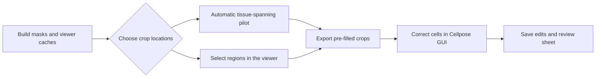

# Choose and correct HITL pilot crops

There are two ways to choose crops: let MerXen spread a small set across tissue,
or choose locations yourself while inspecting the processed sample in the
viewer. Both produce the same pre-filled correction package for the **separate
Cellpose GUI**. The MerXen viewer selects crop locations; Cellpose edits cell
outlines. The [managed annotation and training workflow](managed-annotation-training.md)
adds viewer-launched editing, saved-crop tracking and reusable named models.



## 1. Prepare the sample once

Use the current Atera integration branch and your usual site/Conda setup. For
a new Atera run, prepare Cellpose masks, enriched stores and viewer caches:

```bash
nextflow run workflows/main.nf -profile dwight,conda \
  --samplesheet samples.csv \
  --analysis_mode atera \
  --segmentation_source cellpose_proseg \
  --viewer_cache_enabled true \
  --stop_stage build_viewer_caches \
  --outdir "$MERXEN_HITL_RUN_OUT"
```

Set `MERXEN_HITL_RUN_OUT` to a fresh private output root. This is the current
Cellpose-to-tiled-ProSeg route, so it includes ProSeg. If the sample has already
been processed, reuse its completed latest/review store and stitching statistics
instead of recomputing it. Atera's default `native` route provides vendor masks,
not Cellpose pre-fills.

Atera Cellpose runs now generate transcript density before segmentation and
use **DAPI → 18S → density** by default, with native-pixel bins and Gaussian
σ = **0.15 µm**. See [the density stage](../stages/atera-transcript-density.md)
for settings, provenance and the explicit two-stain compatibility option.

Create a private `pilot.json` with the config shown in
[the Atera pilot instructions](testing-guide.md#5-atera-correction-pilot).
Point `source_zarr` at the completed latest/review store, `mask_key` at
`cellpose_cell_labels`, and `baseline_stats_path` at the original Cellpose
`cellpose_stitching_stats.json`. Keep the source and published output in
`protected_roots`. Use a fresh `output_dir` for every export.

New stitching statistics locate the density raster automatically. For older
two-stain prefills, add `transcript_density_path` to a newly generated raster
and omit `channels` to export DAPI, 18S and density for future training.

The initial crop exporter supports native Atera and Xenium images. Neither
path loads transcript partitions or whole-transcriptome expression tables.

## 2A. Automatically selected crops

Leave `boxes` and `roi_geojson_path` unset, then run in the pipeline environment:

```bash
merxen cellpose-hitl-export --config pilot.json
```

Defaults select six 768 px crops with at least 90% coverage by an image-derived
tissue mask and spread them spatially. Inspect `context/overview.png` and the
per-crop previews before correcting anything. This is an unstratified training
pilot, not an anatomically balanced or held-out test set. Selection does not
rank windows by segmentation errors.

Continue at step 3. The archive also contains `roi_context.json`, which can be
used later to choose a different set of locations in the viewer.

## 2B. Regions selected in the viewer

### Prepare the small viewer context file

On the pipeline machine, before opening the sample for ROI selection:

```bash
merxen cellpose-hitl-prepare-rois --config pilot.json --output roi_context.json
```

This reads image metadata and the original tile grid, and writes a small JSON
file and its companion `hitl_export_settings.json`. It creates no crops or
masks. Copy both files together to the machine running the viewer. Local package
creation also needs the native image/Cellpose-label store and, for three-channel
Atera, the existing matching `transcript_density.zarr`.

### Select locations

Start the current viewer in its usual environment:

```bash
napari-compare-xenium-merscope --atera-zarr "<completed-store.zarr>" \
  --skip-transcripts
```

Open the sample **standalone in its native frame**. Load the native morphology
stains and display the Cellpose segmentation (`MOSAIK_cellpose` /
`cellpose_cell_labels`); the viewer initially shows vendor masks for Atera.
Transcript loading is unnecessary for crop selection.

Choose **HITL seg crops** in the viewer's right-hand controls. No Python console
or MerXen installation in the viewer environment is needed.

1. Click **Load crop setup…** and select `roi_context.json`. The viewer checks
   the source identity and remembers matching setups. It also discovers a
   `merxen_hitl_roi_context.json` inside the store or `roi_context.json` beside it.
2. With the native `morphology_focus` image visible, click **Add rectangular crop**,
   then click and drag to draw one crop. Press the button again for each new crop.
3. Select a crop in the list to move or resize it. Width and height are free,
   with a minimum of 256 native pixels on each axis. Keep each rectangle entirely
   inside one cyan guide and keep crops separate. The guides preserve the
   full-tile normalization context; crossing them is refused on export.
4. The list shows each crop's estimated Cellpose cell count. The total counts
   unique nonzero Cellpose labels touching the crops and turns green between
   800 and 1,200. Counts read selected mask windows in the background; no
   transcript scan is required. Missing masks are reported rather than replaced
   with vendor counts. This is a prefill estimate, not the final corrected count.
5. Choose representative tissue as well as difficult areas, then click **Save
   areas and prepare annotation**. The viewer creates all Cellpose files in a
   fresh folder beside the Zarr. Select a crop and press **Annotate cell masks**;
   save and close Cellpose to mark it green and proceed to the next crop.
   [Continue with the managed workflow](managed-annotation-training.md).

For remote export, **Save regions only…** writes a new `.geojson` outside the
source store. Existing files are preserved. The instructions below describe
that alternative; it is unnecessary for local package creation.

The general cortical-depth/object annotation buttons are not used here; those
tools serve other analyses and are disabled for Atera. The crop tab does not
modify the SpatialData store.
Aligned, reflected, shifted and native-pixel-unit image views are refused.

The older console helper remains available for programmatic square selection:

```python
from merxen.segmentation.hitl.viewer import add_roi_picker

picker = add_roi_picker(viewer, "roi_context.json", regions_path="hitl-regions.geojson")
```

### Export the selected regions as pre-filled crops

Copy the GeoJSON back to the pipeline machine. Make `selected-pilot.json`
from the same `pilot.json`, change `output_dir` to a new destination and add:

```json
"roi_geojson_path": "<saved-hitl-regions.geojson>"
```

Leave `boxes` unset. Keep the source, dataset alias, crop size, margin and
baseline-grid settings the same as when the context was prepared. Then run:

```bash
merxen cellpose-hitl-export --config selected-pilot.json
```

Use the rectangle-enabled exporter for the native viewer's version-two region
files; older square-only exporters refuse free rectangles. Existing square
region files and automatic square crops remain supported.

The file binds selections to the source and tile-grid checksums. Coordinates
are saved as GeoJSON `(x, y)` in native level-zero pixels; the helper/exporter
handle the viewer's `(y, x)` micron display without manual coordinate edits.
The resulting manifest records `viewer_rois`, stable ROI IDs, exact crop bounds
and the selection-file hash. `selected_regions.geojson` is preserved with it.

## 3. Correct cells in the separate Cellpose GUI

Prepare the drawing environment once on the annotation machine, from the
current MerXen checkout. The generated GUI lock is separate from the pipeline
lock and includes Cellpose's Qt extras:

```bash
uv venv --python 3.12 .hitl-gui-venv
uv pip install --python .hitl-gui-venv/bin/python --no-deps \
  -r requirements/requirements.hitl-gui.lock
.hitl-gui-venv/bin/python -m cellpose
```

Keep the pipeline and viewer in their existing environments. The drawing GUI
works locally on CPU; no GPU, server connection or model inference is needed
to correct the exported masks.

For density-enabled Atera packages, model and display channels are **DAPI,
18S RNA and transcript density**. Cellpose RGB shows them in red, green and
blue respectively; package previews show DAPI blue, 18S green and density red.
Older two-stain packages keep an empty third model slot and can display the
boundary stain instead. `model_channels` and `view_channels` in each manifest
record the actual choices; earlier archives and annotations are preserved.

The recommended route for either selection method is **Open annotation
package…** in the viewer, then **Annotate cell masks**. This preserves older
prefills/edits in a fresh managed copy and tracks actual saves. See
[annotation, transfer and training](managed-annotation-training.md).

For the older standalone correction workflow:

1. Copy `annotation-pilot.tar.gz` to the annotation laptop and extract it into a
   fresh folder. Keep an untouched archive as the audit copy.
2. Open a root-level TIFF in the **Cellpose 4.2.1.1 GUI**. Its matching
   `_seg.npy` supplies the pre-filled masks. This is where cell outlines are edited.
3. Follow the package's versioned `annotation-guide.md`. Correct every visible
   cell consistently, including missing cells and false masks.
4. Press **Ctrl+S** for each crop, even if no edit was needed. Mark it `reviewed`
   in `review.tsv` only after saving; record minutes and uncertainties. Use
   `excluded` with a reason for unusable tissue.
5. Return corrected `_seg.npy` files, `review.tsv` and the original manifest.
   Keep image, raw and model-input files unchanged. Do not train in the GUI.
   To train with the managed importer, open the package in the current viewer
   and save each crop once through its launched Cellpose window.

The exported model inputs were normalized on the complete original halo tile
before cropping; future server training must use `normalize=False`. Changing
display contrast in either GUI does not replace those arrays. Both workflows
preserve the original masks, source store and earlier annotation exports.
