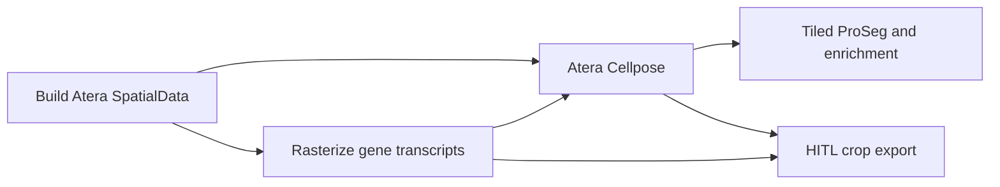

# Atera transcript density before Cellpose

For Atera `cellpose_proseg` runs, the pipeline now prepares a density raster
between `BUILD_SPATIALDATA` and `ATERA_CELLPOSE_SEGMENT`. The ordered model inputs
are **DAPI, 18S RNA, transcript density**. The native stains are retained intact;
the density is a separate SpatialData image on exactly the same pixel grid.
Vendor-only Atera routes do not run this step.



## Recipe

- Count **all retained gene transcripts with QV ≥ 20**, including unassigned
  transcripts, across all z planes. `is_gene` excludes controls. No cell labels,
  vendor assignments or Cellpose masks determine which transcripts are counted.
- Map raw micron coordinates using Atera's native float32 corner convention.
  Reject nonfinite coordinates and points outside the morphology image, with
  their counts recorded. Integer bin counts must conserve the accepted total.
- Default to **one native pixel per bin** and **Gaussian σ = 0.15 µm**,
  selected after comparing 0.15, 0.25 and 0.5 µm on neuronal tissue. This is a
  working input recipe, not a measured optimum for segmentation accuracy.
- Express the smoothed raster in transcripts/µm². Smoothing is global, with a
  four-sigma kernel and reflected image boundaries. Optional larger bins are
  reconstructed at native pixel centres with bilinear interpolation.
- Normalize each of the three model channels independently at p2/p98 on the
  **complete inference halo tile**, convert to uint8, then use Cellpose's
  usual normalization. Independent scaling prevents fluorescence magnitudes
  from erasing a density channel measured in different units. HITL crops use
  this same preparation before cropping.

Sigma describes the Gaussian standard deviation, not a new imaging resolution.
The native pixel pitch remains whatever the sample metadata records. A store
built with a stricter upstream transcript filter cannot recover discarded rows.
These figures describe a 2D projection of the retained transcripts, not a
volumetric RNA concentration.

[10x's decoding documentation](https://www.10xgenomics.com/support/software/atera-onboard-analysis/latest/algorithms-overview/algo2_decoding)
describes the Q20 gene-transcript convention. Cellpose accepts three input
channels, but its authors recommend retraining for a third fluorescence input;
this added modality therefore still needs corrected-mask validation and HITL
fine-tuning, rather than an assumption that stock masks will improve.
See [Cellpose channel settings](https://cellpose.readthedocs.io/en/latest/settings.html).

## Run and configure

Use the usual Atera pipeline command with `--segmentation_source cellpose_proseg`.
When testing an unmerged checkout, put its `src` directory on `PYTHONPATH`
so the existing environment runs that checkout's code.
The new default applies when segmentation is run. Parameters are:

| Parameter | Default | Meaning |
|---|---:|---|
| `--atera_transcript_density_enabled` | `true` | Generate and feed the third channel. |
| `--atera_transcript_density_min_qv` | `20` | Minimum retained gene QV. |
| `--atera_transcript_density_sigma_um` | `0.15` | Physical Gaussian σ. |
| `--atera_transcript_density_bin_size_px` | `1` | Integer native-pixel bin width. |

Use a **fresh output directory** for the three-channel run. Its inputs and
normalization differ from the historical two-stain run, so old masks are not
silently reused. To retain the historical Atera two-stain route, pass
`--atera_transcript_density_enabled false`. No existing run is rewritten just
because this code is installed.

Outputs are published under `<pair>/atera/transcript_density/`:
`transcript_density.zarr` and `transcript_density.json`. The manifest records
the recipe, exact counts, native geometry and source/raster identities. The
process reads four parquet columns in bounded batches; it never materializes
the transcript dataframe or loads an expression table. The native histogram
and smoothing arrays determine memory use (64 GB process reservation).

For a standalone raster, create a private JSON file:

```json
{
  "source_zarr_path": "<built-or-review-store.zarr>",
  "output_dir": "<new-independent-density-folder>",
  "min_qv": 20,
  "bin_size_px": 1,
  "sigma_um": 0.15
}
```

```bash
merxen atera-transcript-density --config density.json
```

The original source is read only. A nonempty output directory is refused.
An unfinished store has no completed manifest and cannot be used for inference.

## HITL and model provenance

The model identity records the exact raster fingerprint and its portable
recipe. A custom model must declare all three channels, the same
`transcript_density_profile`, and `evaluated_cellpose.input_normalization =
"per_channel"` in `model.json`. Two-stain checkpoints remain usable with the
two-stain route; accepted fine-tuned models do not silently change their inputs.

`cellpose-hitl-export` discovers the raster from new stitching statistics.
To use a new density raster with older prefills, set `transcript_density_path`
explicitly in the pilot config and omit `channels` to select the three inputs.
This writes a fresh package and preserves earlier annotations. The manifest
distinguishes the prefill model from the input recipe prepared for future
training. The TIFF shows these three channels; the boundary stain is then not
one of the displayed/model channels. Future training still uses the exported
normalized arrays with `normalize=False`.

See [automatic and viewer-selected correction workflows](../hitl/pilot-workflows.md).

## Inspect example inputs

The acceptance preview compares the same native locations and creates an
overlay, individual-channel panels and three Gaussian-width comparisons:

```bash
python scripts/acceptance/atera_density_preview.py \
  --source-zarr "$MERXEN_HITL_SOURCE_ZARR" \
  --pilot-manifest "$MERXEN_HITL_PILOT_MANIFEST" \
  --output-dir "$MERXEN_HITL_DENSITY_PREVIEWS" \
  --sigma-um 0.15 --bin-size-px 1 --compare-sigmas 0.15 0.25 0.5
```

The colours are **DAPI blue, 18S green, density red**. Separate grayscale panels
show each channel. Per-panel p2/p99 display contrast is labelled; it does not
alter the physical raster or the inference normalization. Scale bars are in µm.
